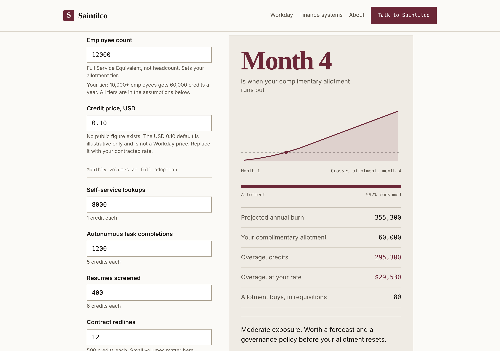

# Flex Credits Calculator

**Free. No signup. Nothing you enter leaves your browser.**

**Run it:** https://saintilco.com/calculator.html

Workday AI Flex Credits are how Workday meters its AI agents. Workday publishes credits per action but no dollar price per credit. Put in your full-service-equivalent count and your monthly volumes, and the calculator shows which month your complimentary allotment runs out and what the overage costs at the credit price you enter.

## Sample

`samples/example-inputs.md` lists the made-up inputs the page opens with and the result they give.

Rates come from Workday's public Flex Credits Rate Card; the page shows the card date it uses. The USD 0.10 default credit price is illustrative only and is not a Workday price. Replace it with your contracted rate.

This is triage. It excludes platform entitlements such as API calls and document storage, and it does not stress-test your volumes.

## How it is tested

Checked in Chrome against the live build on 11 November 2026. All 4 scenarios passed:

| Scenario | Expected and seen |
|---|---|
| Example inputs | Allotment runs out in month 4 |
| Credit price doubled | Same month; only the cost changes |
| Agent volumes doubled | Runs out earlier, in month 3 |
| Zero volumes | Not this year: stays inside the allotment |

## What this repository is

A showcase: what the tool does, what it looks like, made-up sample files to try it with, and how it is checked. The tool itself runs on saintilco.com. **No source code, test suites or answer keys are published here.**

Everything in `samples/` is fictional. No client data, real names or real figures appear anywhere in this repository.

## About

Built by [Saintilco Consulting](https://saintilco.com), independent Workday Financials controls reviews. Saintilco Consulting is not affiliated with, sponsored by, or endorsed by Workday, Inc. WORKDAY is a trademark of Workday, Inc. Commercial and systems guidance only, not legal, tax, accounting or audit advice.

Copyright 2026 Saintilco Consulting. All rights reserved. No license is granted to copy, modify or redistribute the tool or this material.
